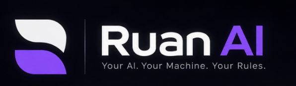

<p align="center">
  
</p>

<p align="center">
  <strong>Your AI. Your Machine. Your Rules.</strong><br />
  <em>A private, locally hosted personal AI operating companion.</em>
</p>

<p align="center">
  
  
  
  
  
  
</p>

---

## Vision & Objectives

* **Local-First & Private:** Run inference locally via LM Studio, with local speech-to-text (STT) and text-to-speech (TTS), persisting data in a local SQLite database. Raw voice recordings are held only in transient memory during transcription and are never stored on disk.
* **Unified Multimodal Core:** Text and voice share the exact same conversation engine and session history. A voice prompt is transcribed and fed into the canonical chat stream, while responses can be read or spoken aloud simultaneously.
* **Intelligent Operating Companion:** Progress from foundational conversation to active computer assistance (file searching, system interaction, approved operations).
* **Agentic Workflows:** Leverage LangGraph.js for deterministic and semi-autonomous multi-step reasoning, planning, and tool execution.
* **Controlled & Safe:** Every privileged or potentially destructive file or OS action requires explicit user permission.
* **Hardware Conscious:** Optimized for consumer hardware (Intel Core i5 13th Gen, 16 GB RAM, RTX 3050 Laptop GPU with 6 GB VRAM). All memory allocations and throughput estimates are subject to empirical benchmarking on the target machine.

---

## Key Features (Roadmap Overview)

* **Natural Language Chat & Streaming:** Real-time token streaming from local LLMs to a responsive React UI.
* **Integrated Voice Interaction (Phase 1):** Push-to-talk microphone input, candidate local STT transcription, candidate local TTS audio synthesis, instant playback interruption, and seamless switching between text-only and voice modes.
* **Persistent Memory (Phase 2):** Multi-tiered memory architecture (active session context, conversation history, and long-term vector/keyword retrieval) stored in SQLite.
* **Agentic Orchestration (Phase 3):** State-graph task execution, tool calling, and structured reasoning with LangGraph.js.
* **Local System & File Operations (Phase 4):** Safe local file querying, file inspection, and program launching under explicit user consent policies.
* **Desktop Companion Experience (Phase 5):** Electron shell providing system tray access, global hotkeys, background persistence, and native notifications.
* **Advanced Voice & Autonomy (Phase 6):** Wake-word detection ("Hey Ruan"), hands-free continuous dialogue, and autonomous workflows.

---

## Technology Stack

| Layer | Technology | Primary Role |
|---|---|---|
| **Frontend** | React (Vite) | Interactive user interface, audio capture/playback, and chat surface |
| **Styling** | Vanilla CSS | Custom design system, responsive layouts, CSS variables |
| **Backend** | Node.js (Express) | API server, stream proxy, audio processing gateway, and tool runner |
| **AI Runtime** | LM Studio | Local LLM inference server exposing OpenAI-compatible endpoints with configurable context |
| **Speech-to-Text (STT)** | `faster-whisper` / `whisper.cpp` | **Candidate engines under evaluation** (CPU-optimized local transcription) |
| **Text-to-Speech (TTS)** | `Piper` / `Kokoro` | **Candidate engines under evaluation** (Low-latency streaming neural synthesis) |
| **Database** | SQLite | Local relational storage for chats, settings, and memory (Phase 2) |
| **Agent Framework** | LangGraph.js | Stateful multi-step agent orchestration and tool execution (Phase 3) |
| **Desktop Shell** | Electron | Native Windows window management, system tray, global hotkeys (Phase 5) |
| **Language** | JavaScript (ES Modules) | Consistent language across client, server, and desktop |

---

## High-Level Architecture

```text
┌────────────────────────────────────────────────────────────────────────┐
│                   Desktop Shell (Electron — Phase 5)                   │
│  ┌───────────────────────┐   ┌───────────────────────────────────────┐ │
│  │   Frontend (React)    │   │         Audio I/O Subsystem           │ │
│  │   Vanilla CSS UI      │   │ (Push-to-Talk Mic / Audio Player)     │ │
│  └───────────┬───────────┘   └───────────────────┬───────────────────┘ │
└──────────────┼───────────────────────────────────┼─────────────────────┘
               │ HTTP / SSE (Localhost)            │ Audio Blobs / Chunks
┌──────────────▼───────────────────────────────────▼─────────────────────┐
│                   Backend Service (Node.js / Express)                  │
│  ┌─────────────────────────┐   ┌─────────────────────────────────────┐ │
│  │  Controllers & API      │   │  Unified Conversation Orchestrator  │ │
│  │ (/api/health, chat/abort│   │  (Shared Text & Voice Pipeline)     │ │
│  └───────────┬─────────────┘   └──────────────────┬──────────────────┘ │
│              │                                    │                    │
│  ┌───────────▼─────────────┐   ┌──────────────────▼──────────────────┐ │
│  │   LangGraph.js Engine   │   │  Voice Processing Gateway           │ │
│  │   (State Graph & Tools) │   │  (Candidate STT / Candidate TTS)    │ │
│  └───────────┬─────────────┘   └─────────────────────────────────────┘ │
│              │                                                         │
│  ┌───────────▼─────────────┐                                           │
│  │   SQLite Database       │                                           │
│  │   (Memory & Chats P2)   │                                           │
│  └─────────────────────────┘                                           │
└───────────────────────┬────────────────────────────────────────────────┘
                        │ OpenAI-compatible API
┌───────────────────────▼────────────────────────────────────────────────┐
│                   Local AI Runtime (LM Studio)                         │
│       Local Quantized Models (Configurable Context & Offload)          │
└────────────────────────────────────────────────────────────────────────┘
```

---

## Standardized API Endpoints

| Endpoint | Method | Responsibility |
|---|---|---|
| `/api/health` | `GET` | Decoupled health check: server status + independent readiness of LM Studio, STT, and TTS |
| `/api/chat/stream` | `POST` | Primary conversation endpoint; streams response tokens via SSE |
| `/api/chat/abort` | `POST` | Immediately aborts active LLM generation and cancels in-flight TTS synthesis |
| `/api/auth/config` | `GET` | Returns public Google OAuth client configuration (`googleClientId`, `isConfigured`) |
| `/api/auth/google` | `POST` | Verifies incoming Google ID token with Google, upserts local SQLite user identity, and issues secure HttpOnly session cookie |
| `/api/auth/me` | `GET` | Returns authenticated profile (`sub`, `name`, `email`, `picture`, `createdAt`) from valid session cookie |
| `/api/auth/logout` | `POST` | Invalidates session in SQLite database and clears session cookie |
| `/api/voice/transcribe` | `POST` | STT endpoint: receives audio blob, transcribes locally via faster-whisper with Hinglish detection, discards raw audio |
| `/api/voice/synthesize` | `POST` | TTS endpoint: receives text string, synthesizes neural audio via Kokoro 82M with sentence chunking |
| `/api/voice/health` | `GET` | Reports independent STT and TTS readiness from local Python voice service |
| `/api/voice/voices` | `GET` | Returns list of available Kokoro voice profiles (54 local voices) |

---

## Current Project Status

* **Status:** Phase 1.6 Local Voice Assistant with Hinglish Support Implemented (`v0.1.0-alpha.5`).
* **Active Functionality:**
  * **Frontend (`client/`):** React + Vite SPA with zero-framework Vanilla CSS styling, public landing page (`/`), dedicated desktop-style conversation interface (`/app`), explicit route resolution with 404 fallback, multi-turn chat history, safe markdown rendering, syntax-highlighted code blocks with copy buttons, in-memory conversation search, robust `localStorage` persistence, Push-to-Talk recording (`useVoice`), auto-speaking **Voice Mode** toggle, and per-message Speak/Stop audio controls.
  * **Backend (`server/`):** Node.js + Express backend with decoupled `/api/health` diagnostics, LM Studio streaming gateway (`POST /api/chat/stream`), model reasoning token suppression, generation cancellation (`POST /api/chat/abort`), and voice API gateway (`/api/voice/transcribe`, `/api/voice/synthesize`, `/api/voice/health`, `/api/voice/voices`).
  * **Local Voice Service (`voice-service/`):** Standalone Python FastAPI microservice on `127.0.0.1:8008` hosting `faster-whisper` (multilingual STT with auto language detection, VAD, INT8 CPU optimization) and `Kokoro 82M` (neural TTS with 54 voices and language-aware Hinglish code-switching routing).
  * **Authentication & Identity System:** Google Identity Services integration with server-side ID token verification using official `google-auth-library`, persistent SQLite session storage (`ruan_auth.db`), HttpOnly cookies, fallback avatars, and polished account management dropdown without cloud synchronization.
  * **Local AI Runtime:** LM Studio connected via OpenAI-compatible endpoints with locally loaded **Gemma 4 E2B IT QAT** (`gemma-4-e2b-it-qat`) model. (LM Studio must have the matching model loaded and its local API server running on `http://localhost:1234/v1`).
* **Next Development Milestone:** Phase 2: Persistent Memory & Context Window Management with SQLite.

---

## Documentation Quick Links

* [Architecture Guide](docs/ARCHITECTURE.md) — Detailed component responsibilities, voice pipeline, and data flows.
* [Roadmap](docs/ROADMAP.md) — Phased breakdown and delivery criteria including Basic Voice in Phase 1.
* [Technology Stack](docs/TECH_STACK.md) — Rationale for chosen technologies, STT/TTS engine evaluations, and VRAM management.
* [Project Structure](docs/PROJECT_STRUCTURE.md) — Directory organization and module placement guide.
* [Development Guide](docs/DEVELOPMENT.md) — Setup prerequisites and local workflows.
* [Security & Safety](docs/SECURITY.md) — Local privacy, audio permissions, and execution guardrails.
* [AI Coding Guidelines](AGENTS.md) — Conventions and constraints for AI coding assistants.
* [Contributing Guide](CONTRIBUTING.md) — Contribution process and code quality rules.
* [Architectural Decisions](docs/decisions/README.md) — ADR index and template.
* [Changelog](CHANGELOG.md) — Version history and project milestones.
