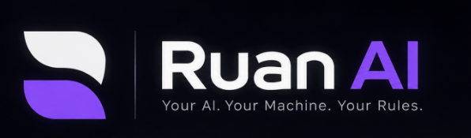

<p align="center">
  
</p>

# Ruan AI — Client (`client/`)

This directory houses the frontend multimodal user interface for **Ruan AI**.

---

## Intended Responsibilities

The client is strictly responsible for presentation, user interaction, audio I/O, and real-time state management:
* **Unified Chat Interface:** Rendering natural language conversation threads where spoken and typed messages share the exact same message history and session context.
* **Stream Rendering:** Consuming Server-Sent Events (SSE) from `/api/chat/stream` and rendering markdown/text in real time.
* **Audio Input (Push-to-Talk):** Capturing microphone audio strictly on user push-to-talk activation via standard browser Web Audio API / `MediaRecorder`. No ambient listening; raw audio is transient and never stored permanently.
* **Audio Playback & Instant Interruption:** Enqueuing and playing synthesized neural voice response chunks. Clicking the Stop button, activating Push-to-Talk, or submitting new input immediately silences playback, flushes the audio queue, and calls `/api/chat/abort`.
* **Interaction Mode Switching:** Providing a seamless toggle between **Voice Mode** (spoken audio responses + text) and **Text-Only Mode** (silent text streaming).
* **Decoupled Diagnostics:** Rendering status indicators for LM Studio, STT, and TTS based on `/api/health` without failing if a single dependency is offline.
* **Google Authentication & User Profile:** Seamless Google Identity Services integration with subtle sign-in trigger, fallback avatar handling, glassmorphic account popover, session restoration via `/api/auth/me`, and zero layout shift.
* **Conversation Management (Phase 2):** Displaying active and previous conversation sessions retrieved from the backend.
* **User Confirmation Prompts (Phase 4):** Presenting approval modals and permission prompts when agent tools request permission to perform system or file operations.

---

## Architectural Boundaries

* **No Direct AI API Calls:** The frontend must never talk directly to LM Studio, external AI APIs, or local model binaries. All interactions pass through the Express backend (`server/`).
* **No Direct Database or File Access:** The frontend never connects to SQLite or executes Node.js filesystem APIs directly.
* **Vanilla CSS Only:** Do not install Tailwind CSS or bulky UI component libraries. All styling is written using scoped, modular Vanilla CSS with CSS custom properties.

---

## Technology Stack

* **Build Tool & Framework:** React (Vite)
* **Language:** JavaScript (ES Modules)
* **Audio APIs:** Web Audio API, `MediaRecorder`, HTML5 `Audio` element
* **Styling:** Vanilla CSS (CSS variables, flexbox, CSS grid, glassmorphism design tokens)
* **Icons / Assets:** Lightweight SVG icons

---

## Planned Directory Structure

```text
client/
├── public/                 # Static assets (favicons, icons)
├── src/
│   ├── assets/             # SVGs, icons, audio cues
│   ├── components/         # Reusable UI components (ChatBox, MessageItem, AudioControls, ModeToggle, Modal)
│   ├── pages/              # Main view screens (ChatView, SettingsView, MemoryView)
│   ├── hooks/              # Custom React hooks (useChatStream, useAudioRecorder, useAudioPlayer, useTheme)
│   ├── services/           # API client services communicating with server/ (chatService, voiceService)
│   ├── styles/             # Global CSS variables, themes, reset, and layout styles
│   ├── App.jsx             # Top-level application shell and routing
│   └── main.jsx            # React root mount point
├── index.html              # HTML entrypoint
├── package.json            # Client package dependencies and scripts
└── vite.config.js          # Vite build configuration and proxy setup
```

---

## Current Status
 
* **Status:** Phase 1.6 Implemented (`v0.1.0-alpha.5`).
* **Active Components:**
  * Public Landing Page (`/`) with cinematic loading screen, sound effects, 3D orb centerpiece, architecture diagrams, and diagnostics modal.
  * Dedicated Conversation Application (`/app`) with collapsible sidebar, multi-turn chat, safe markdown rendering, syntax-highlighted code blocks with copy, dynamic model status indicator (configured for Gemma 4 E2B IT QAT), and robust `localStorage` persistence.
  * Push-to-Talk voice interface (`useVoice.js`, `MessageComposer.jsx`) with microphone button, live recording waveform animation, transcribing spinner, and error banner notifications.
  * Speech synthesis playback (`voiceApi.js`, `MessageBubble.jsx`) with inline Speak/Stop buttons on assistant messages.
  * Auto-speaking **Voice Mode** toggle pill in header bar with session persistence.
  * Instant audio interruption: silences audio and clears queues when user clicks Stop, begins a new recording, or switches conversations.
* **Next Milestone:** Phase 2: Persistent Memory & Context Window Management with SQLite.
