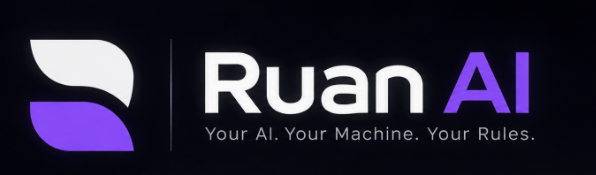

<p align="center">
  
</p>

# Ruan AI — Server (`server/`)

This directory houses the backend service, API layer, AI runtime gateway, voice processing subsystem, memory system, and agent execution engine for **Ruan AI**.

---

## Intended Responsibilities

The server is the core operational brain of Ruan AI:
* **API Gateway & Standardized Routes:**
  * `GET /api/health` — Decoupled server health reporting Express uptime and independent readiness of LM Studio, STT, and TTS.
  * `POST /api/chat/stream` — Unified conversation stream emitting SSE token chunks (and coordinating voice synthesis).
  * `POST /api/chat/abort` — Cancels in-flight LLM generation and aborts active TTS synthesis.
  * `POST /api/voice/transcribe` — Dispatches audio blob to local STT candidate; returns transcribed text and immediately frees raw audio from memory.
  * `POST /api/voice/synthesize` — Dispatches text string to local TTS candidate; returns synthesized audio buffer.
  * `GET /api/auth/config` — Returns public Google Identity Services configuration (`googleClientId`, `isConfigured`).
  * `POST /api/auth/google` — Verifies incoming Google ID token with Google, upserts local SQLite user identity, and issues secure HttpOnly session cookie.
  * `GET /api/auth/me` — Returns authenticated profile (`sub`, `name`, `email`, `picture`, `createdAt`) from valid session cookie.
  * `POST /api/auth/logout` — Invalidates session in SQLite database and clears session cookie.
* **Google Authentication & Identity Subsystem:** Independent server-side cryptographic token verification using official `google-auth-library` and persistent session management via SQLite (`ruan_auth.db`).
* **Unified Conversation Orchestrator:** Manages the canonical conversation state. Spoken and typed interactions share the exact same context window and conversation history.
* **LM Studio Client:** Manages communication with the locally running LM Studio inference server (`http://localhost:1234/v1`) using configurable context windows and model parameters.
* **Voice Processing Subsystem (Phase 1):**
  * **STT Candidate Adapter:** Dispatches incoming audio recordings to candidate speech recognition engines (`faster-whisper` / `whisper.cpp`) running on CPU threads.
  * **TTS Candidate Adapter:** Buffers streaming text into sentences, dispatches to candidate neural speech synthesizers (`Piper` / `Kokoro`), and handles immediate cancellation when aborted.
* **Memory Management (Phase 2):** Interfaces with SQLite to persist conversation logs, summarize session context, and store long-term retrieval data.
* **Agent Orchestration (LangGraph.js — Phase 3):** Coordinates multi-step reasoning loops, agent state graphs, and tool invocation pipelines.
* **System Tools & Safe Execution (Phase 4):** Houses modular tools (file searching, document reading, application launching) behind strict confirmation middleware.

---

## Architectural Boundaries

* **Decoupled Voice & LLM Services:** STT and TTS services are standalone adapters decoupled from the LLM client, allowing independent maintenance and CPU/GPU resource optimization.
* **Decoupled Health Reporting:** Server uptime is independent of external AI services; if LM Studio or voice binaries are not yet loaded, `/api/health` returns status without crashing.
* **Strict Local Binding:** Binds strictly to `127.0.0.1` (localhost) to ensure privacy and security.
* **Guarded Tool Execution:** System tools are isolated in dedicated modules with authorization checks. No tool may directly execute unverified shell strings.

---

## Technology Stack

* **Runtime:** Node.js (v20.x or v22.x LTS recommended)
* **Framework:** Express.js (ES Modules)
* **Speech-to-Text Candidates:** `faster-whisper` / `whisper.cpp` (Evaluated on CPU)
* **Text-to-Speech Candidates:** `Piper` / `Kokoro` (Evaluated for streaming sentence chunks and instant cancel)
* **AI Runtime Protocol:** OpenAI-compatible REST API (targeting LM Studio on port 1234)
* **Database Driver:** SQLite (`better-sqlite3` or SQLite3 — Phase 2)
* **Agent Engine:** LangGraph.js (Phase 3+)

---

## Planned Directory Structure

```text
server/
├── src/
│   ├── config/             # Environment variables, constants, LM Studio URLs
│   ├── routes/             # Express route definitions (chat, voice, memory, tools, health)
│   ├── controllers/        # Request handlers (chatController, voiceController, healthController)
│   ├── services/           # Core services (lmStudioService, sttService, ttsService, conversationOrchestrator)
│   ├── agents/             # LangGraph state graphs, nodes, and reasoning routines (Phase 3)
│   ├── tools/              # Modular local tools (file search, app launcher) (Phase 4)
│   ├── middleware/         # Error handling, request validation, safety/permission gates
│   └── app.js              # Express app initialization and server entry point
├── data/                   # Local SQLite database files (gitignored)
├── package.json            # Server package dependencies and scripts
└── .env.example            # Environment configuration template
```

---

## Current Status

* **Status:** Phase 1 & Phase 1.5 Implemented (`v0.1.0-alpha.4`).
* **Active Components:**
  * Express.js HTTP/SSE server running on `http://127.0.0.1:5000` with CORS, error-handling middleware, and structured logging.
  * Decoupled health reporting (`GET /api/health`) dynamically detecting LM Studio readiness and loaded models (default model: `gemma-4-e2b-it-qat`).
  * Real-time streaming gateway (`POST /api/chat/stream`) with Server-Sent Events, token buffering, and model reasoning suppression.
  * In-flight generation cancellation registry (`POST /api/chat/abort`) with AbortController lifecycle management.
  * Native fetch connector (`lmStudioService.js`) targeting local LM Studio on port 1234 (configured for Gemma 4 E2B IT QAT).
* **Next Milestone:** Basic Voice Assistant integration (transient STT endpoint `/api/voice/transcribe` evaluating `faster-whisper` vs `whisper.cpp`, and streaming sentence-chunked TTS adapter `/api/voice/synthesize` evaluating `Piper` vs `Kokoro`).
